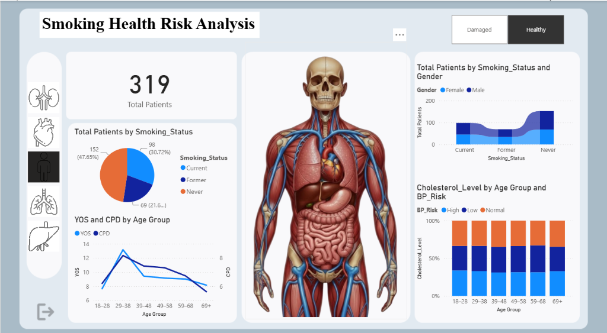
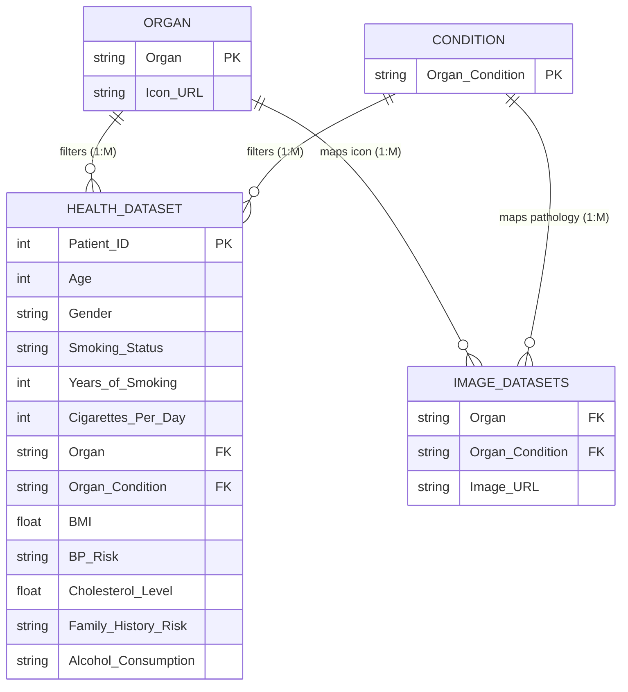

# 🫁 Smoking Health Risk Analysis Dashboard

<div align="center">

[](https://powerbi.microsoft.com/)
[](https://learn.microsoft.com/en-us/dax/)
[](https://learn.microsoft.com/en-us/power-query/)
[](#-data-dictionary)
[](LICENSE)

<br/>

**An executive-grade Healthcare Business Intelligence & Clinical Analytics Dashboard built in Microsoft Power BI Desktop.**  
*Stratifying the multi-system physiological impact of tobacco consumption across clinical cohorts, anatomical systems, and metabolic risk indicators.*

<br/>



<br/>

[Explore Preview](#-executive-dashboard-preview) • [Key Insights](#-key-clinical--business-insights) • [Data Model](#-data-architecture--relational-model) • [DAX Measures](#-advanced-dax-calculations) • [Setup Guide](#-installation--exploration-guide)

---

</div>

## 📌 Executive Summary

Tobacco consumption remains a leading cause of preventable cardiovascular, pulmonary, and systemic organ morbidity worldwide. This project delivers an end-to-end clinical intelligence solution engineered to evaluate patient health outcomes across **2,500 diverse clinical profiles**. 

By synthesizing patient behavioral data (**Years of Smoking**, **Cigarettes per Day**) with multi-system diagnostic biomarkers (**Body Mass Index**, **Blood Pressure Risk**, **Serum Cholesterol Levels**, and **Target Organ Pathology**), the dashboard provides healthcare providers, public health analysts, and clinical researchers with an interactive decision-support interface.

---

## 📸 Executive Dashboard Preview


*Figure 1: Full-screen interactive Power BI interface featuring dynamic 3D anatomical rendering, multi-variate cohort segmentation, and dynamic variance KPIs.*

---

## 🎯 Key Clinical & Business Insights

### 🫀 1. Dynamic 3D Anatomical Organ Visualization
- **Context-Aware Visual States:** Integrates cloud-hosted 3D anatomical models dynamically mapped via DAX and Power Query.
- **Bi-State Pathology Mapping:** Visualizes both **Healthy** and **Damaged** tissue states across five vital organ classifications: **Human Body**, **Heart**, **Lungs**, **Kidney**, and **Liver**.
- **Interactive Slicers with Web Icons:** Built using custom organ dimensional datasets that fetch high-fidelity organ icons directly onto the canvas.

### ⚡ 2. Dynamic Baseline Variance KPIs
- Custom DAX measures benchmark active filter selections against global cohort baselines in real time.
- **Cohort Mean Age (54.0 yrs)** and **Cohort Mean BMI (29.6 kg/m²)** dynamically display directional variance indicators (`▲` higher than baseline / `▼` lower than baseline), immediately flagging elevated-risk demographics.

### 📈 3. Nicotine Dependency & Age Cohort Trajectories
- Dual-axis spline trend line analyzing the intersection between cumulative **Years of Smoking (YOS)** and daily intensity (**Cigarettes per Day (CPD)**) across normalized age cohorts (18–28, 29–38, 39–48, 49–58, 59–68, 69+).
- Highlights critical threshold windows where high nicotine intensity accelerates chronic tissue degeneration.

### 🩺 4. Cardiovascular & Metabolic Risk Stratification
- **100% Stacked Column Visual:** Stratifies **Blood Pressure Risk** (High, Normal, Low) across chronological age buckets.
- Correlates continuous **Serum Cholesterol Concentration (mg/dL)** with smoking tenure and genetic predisposition (**Family History Risk**).

### 👥 5. Demographic Transition Flows
- **Multi-Dimensional Ribbon Chart:** Maps gender-stratified patient volume transitions across distinct behavioral tiers: **Never Smoker**, **Former Smoker**, and **Current Smoker**.

---

## 🏗️ Data Architecture & Relational Model

The analytical engine leverages an optimized dimensional data model ensuring referential integrity and performant filter propagation across visual components.



### 🔗 Relationship Schema & Cardinality
| Primary Dimension | Related Table | Foreign Key | Cardinality | Cross Filter Direction |
| :--- | :--- | :--- | :--- | :--- |
| `Organ[Organ]` | `health_dataset[Organ]` | `Organ` | 1 to Many (`1:*`) | Single (`Organ` filters `health_dataset`) |
| `Organ[Organ]` | `Image Datasets[Organ]` | `Organ` | 1 to Many (`1:*`) | Single (`Organ` filters `Image Datasets`) |
| `condition[Organ_Condition]` | `health_dataset[Organ_Condition]` | `Organ_Condition` | 1 to Many (`1:*`) | Single (`condition` filters `health_dataset`) |
| `condition[Organ_Condition]` | `Image Datasets[Organ_Condition]` | `Organ_Condition` | 1 to Many (`1:*`) | Single (`condition` filters `Image Datasets`) |

---

## 📊 Data Dictionary

The primary clinical cohort dataset comprises **2,500 patient records** spanning 13 clinical, physiological, and behavioral variables:

| Attribute | Data Type | Clinical / Analytical Description | Value Domain / Sample Range |
| :--- | :--- | :--- | :--- |
| `Patient_ID` | Integer | Unique anonymized patient cohort identifier | `1` to `2500` |
| `Age` | Integer | Chronological age at clinical evaluation | `18` to `89` years |
| `Gender` | Text | Biological sex / demographic identifier | `Male`, `Female` |
| `Smoking_Status` | Text | Tobacco smoking behavioral classification | `Current`, `Former`, `Never` |
| `Years_of_Smoking` | Integer | Cumulative active smoking tenure | `0` to `50` years |
| `Cigarettes_Per_Day`| Integer | Daily nicotine intake frequency | `0` to `40` cigarettes/day |
| `Organ` | Text | Anatomical system under diagnostic review | `Human Body`, `Heart`, `Lungs`, `Kidney`, `Liver` |
| `Organ_Condition` | Text | Evaluated clinical status of selected organ | `Healthy`, `Damaged` |
| `BMI` | Decimal | Body Mass Index ($kg/m^2$) | `15.0` to `45.0` |
| `BP_Risk` | Text | Stratified arterial blood pressure risk tier | `Low`, `Normal`, `High` |
| `Cholesterol_Level`| Decimal | Total serum cholesterol concentration ($mg/dL$) | `120.0` to `310.0` |
| `Family_History_Risk` | Text | Hereditary predisposition to cardiovascular disease | `Yes`, `No` |
| `Alcohol_Consumption` | Text | Self-reported alcohol consumption tier | `Low`, `Moderate`, `High` |

---

## 🧮 Advanced DAX Calculations

The dashboard utilizes custom DAX formulas to power dynamic cohort segmentation and contextual KPI indicators.

### 1. Calculated Column: Normalized Age Cohort Buckets
Groups patient ages into standardized 10-year epidemiological brackets for demographic analysis:
```dax
Age Group = 
SWITCH(
    TRUE(),
    health_dataset[Age] <= 28, "18–28",
    health_dataset[Age] <= 38, "29–38",
    health_dataset[Age] <= 48, "39–48",
    health_dataset[Age] <= 58, "49–58",
    health_dataset[Age] <= 68, "59–68",
    "69+"
)
```

### 2. Measure: Dynamic Age KPI with Baseline Variance Indicator
Calculates active filtered cohort average age and displays directional unicode indicators (`▲` / `▼`) against the unfiltered population baseline:
```dax
vs Avg Age = 
VAR _CurrentAge = AVERAGE(health_dataset[Age])
VAR _OverallAge = CALCULATE(AVERAGE(health_dataset[Age]), ALL(health_dataset))
VAR _Diff = _CurrentAge - _OverallAge

RETURN
SWITCH(
    TRUE(),
    _Diff > 0, UNICHAR(9650) & " " & FORMAT(_CurrentAge, "0.0"),
    _Diff < 0, UNICHAR(9660) & " " & FORMAT(_CurrentAge, "0.0"),
    FORMAT(_CurrentAge, "0.0")
)
```

### 3. Measure: Dynamic BMI KPI with Population Baseline Indicator
Dynamically assesses whether selected patient cohorts skew above or below the overall cohort average BMI (29.6):
```dax
vs Avg BMI = 
VAR _CurrentBMI = AVERAGE(health_dataset[BMI])
VAR _OverallBMI = CALCULATE(AVERAGE(health_dataset[BMI]), ALL(health_dataset))
VAR _Diff = _CurrentBMI - _OverallBMI

RETURN
SWITCH(
    TRUE(),
    _Diff > 0, UNICHAR(9650) & " " & FORMAT(_CurrentBMI, "0.0"),
    _Diff < 0, UNICHAR(9660) & " " & FORMAT(_CurrentBMI, "0.0"),
    FORMAT(_CurrentBMI, "0.0")
)
```

### 4. Measure: Dynamic Anatomical Image Selector
Dynamically retrieves cloud-hosted 3D rendering URLs based on interactive organ and condition selections:
```dax
Selected Organ Image = 
CALCULATE(
    SELECTEDVALUE('Image Datasets'[Image URL]),
    TREATAS(VALUES(Organ[Organ]), 'Image Datasets'[Organ]),
    TREATAS(VALUES(condition[Organ_Condition]), 'Image Datasets'[Organ_Condition])
)
```

---

## 📁 Repository Directory Structure

```plaintext
Smoking Health Risk Analysis Dashboard/
│
├── .gitignore                                 # Git rules for Windows & Power BI temporary files
├── Background Viz.png                         # High-resolution glassmorphism canvas layout
├── condition.csv                              # Organ Condition dimension table (Healthy, Damaged)
├── dashboard_preview.png                      # High-resolution executive dashboard screenshot
├── health_dataset.csv                         # Primary clinical cohort dataset (2,500 rows)
├── Image Datasets.csv                         # Dynamic 3D organ image cloud mapping repository
├── LICENSE                                    # MIT Open-Source License
├── Measures and Columns Formula.txt          # DAX measures and calculated column formulas
├── Organ.csv                                  # Organ dimension table with cloud icon URLs
├── README.md                                  # Comprehensive project documentation
└── Smoking Health Risk Analysis.pbip          # Microsoft Power BI Project file
```

---

## 🚀 Installation & Exploration Guide

### Prerequisites
- **Microsoft Power BI Desktop** (November 2023 or newer recommended to support Power BI Project `.pbip` features).
- Internet connection (required for loading cloud-hosted 3D anatomical models and organ icons).

### Step-by-Step Setup

1. **Clone the Repository:**
   ```bash
   git clone https://github.com/aakash1552005/smoking-health-risk-analysis-dashboard.git
   cd "smoking-health-risk-analysis-dashboard"
   ```

2. **Launch the Power BI Project:**
   - Double-click **`Smoking Health Risk Analysis.pbip`** to open the solution in Power BI Desktop.

3. **Data Source Verification:**
   - If prompted by Power BI Desktop to locate data sources, verify that the CSV file paths (`health_dataset.csv`, `Organ.csv`, `condition.csv`, `Image Datasets.csv`) point to the repository root directory.
   - Click **Home > Refresh** to reload and recalculate all visual elements and DAX partitions.

4. **Explore Interactive Features:**
   - Use the **Organ Selector** along the top ribbon to inspect specific organ systems (**Heart**, **Lungs**, **Liver**, **Kidney**, **Human Body**).
   - Toggle between **Healthy** and **Damaged** states to inspect pathological changes.
   - Cross-filter by **Gender**, **Age Group**, or **Smoking Status** to observe dynamic shifts in blood pressure profiles and KPI baseline indicators.

---

## 💡 Clinical Recommendations & Public Health Implications

1. **Early Intervention Windows:** Longitudinal data shows that patient cohorts crossing **15+ Years of Smoking** experience exponential upticks in multi-organ damage risk, highlighting the urgency of cessation interventions before age 40.
2. **Compound Metabolic Comorbidity:** Patients exhibiting concurrent elevated BMI (>30) and high cholesterol display significantly elevated high-risk blood pressure profiles when smoking intensity exceeds **15 Cigarettes per Day**.
3. **Targeted Preventive Screenings:** Former smokers retain persistent cardiovascular and pulmonary risks; tailored annual screenings (low-dose CT, lipid panels) are recommended for patients with >10 cumulative smoking pack-years.

---

## 📄 License

This project is licensed under the **MIT License** — see the [LICENSE](LICENSE) file for complete details.

---

## 👨‍💻 Author & Contact

**Aakash S. S.**  
*Healthcare Analytics & Power BI Data Intelligence*

- 🐙 **GitHub:** [@aakash1552005](https://github.com/aakash1552005)
- 💼 **LinkedIn:** [Aakash S S](https://linkedin.com)
- 📧 **Contact:** [aakash1552005@gmail.com](mailto:aakash1552005@gmail.com)

---

<div align="center">
  <sub>Engineered with precision for advanced healthcare business intelligence and data visualization excellence.</sub>
</div>
